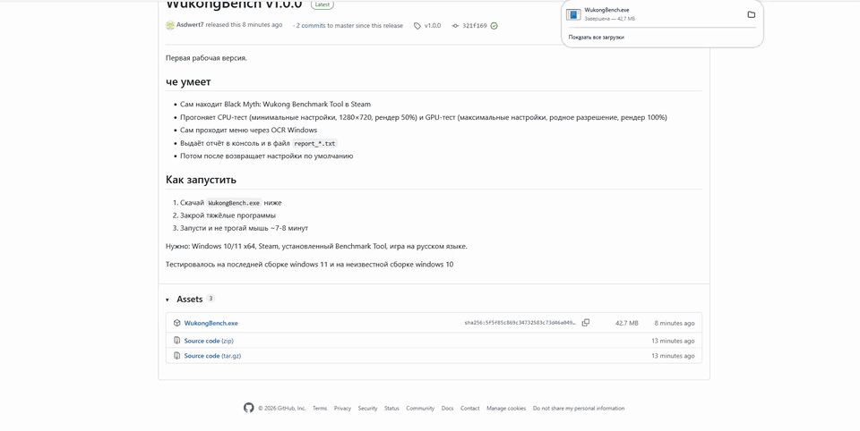
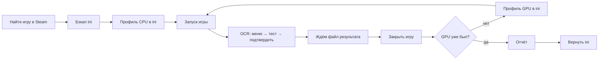

<div align="center">

# 🐒 WukongBench

**Автоматический CPU- и GPU-тест в Black Myth: Wukong Benchmark Tool через мою прогу**

[](https://github.com/asdwert7/WukongBench/releases/latest)
[](https://t.me/Asdwert7)


[](https://store.steampowered.com/app/3132990/Black_Myth_Wukong_Benchmark_Tool)

</div>

---

## 🎬 Демонстрация

<p align="center">
  
</p>


---

## Что это

Консольная программа на C#, которая **полностью сама без вас** прогоняет Black Myth: Wukong Benchmark Tool два раза - с настройками для оценки процессора и с настройками для оценки видеокарты - и выдаёт нормальный отчёт.

Человек ничего не трогает, программа **сама** находит игру в Steam, меняет настройки, **сама** делает окно тулзы активной(ну тоесть свое сворачивает и кликает в угол вуконговской тулзы), запускает тест, нажимает кнопки в меню(видя их буквально зрением🥲), дожидается результата, закрывает игру и возвращает исходные настройки.

---

## ✨ Возможности

| | Возможность | Как сделано |
|:-:|---|---|
| 🔎 | **Поиск игры** | Путь к Steam из реестра, все библиотеки из `libraryfolders.vdf`, папка игры из `appmanifest_3132990.acf` |
| ⚙️ | **Смена настроек** | Правка `GameUserSettings.ini`: блок `UISettingData` (значения меню) и `[ScalabilityGroups]` (группы качества Unreal Engine) |
| 💾 | **Бэкап настроек** | Перед стартом ini копируется в `.bak`, после работы - возвращается обратно, даже если что-то упало |
| 🚀 | **Запуск теста** | Прямой запуск `b1-Win64-Shipping.exe` |
| 👁️ | **Навигация по меню** | Скриншот экрана → встроенный OCR Windows находит «Тест быстродействия» и «Подтвердить» → клик в центр найденного текста |
| 🖱️ | **Заставка** | Клики в угол экрана, пока OCR не увидит главное меню|
| ⏱️ | **Ожидание результата** | Слежка за папкой `%TEMP%\b1\BenchMarkHistory\Tool` - тест закончился, когда появился новый файл |
| 📊 | **Разбор результата** | Файл результата - JSON: FPS, характеристики ПК и **фактически применённые** игрой настройки |
| 🔁 | **Перезапуск между тестами** | Игра закрывается по имени процесса и запускается заново|
| 📝 | **Отчёт** | В консоль и в файл `report_ГГГГММДД_ЧЧММСС.txt` рядом с программой |
| 🧪 | **Режим отладки** | `WukongBench.exe --ocr-dump` - серия скриншотов и всё, что распознал OCR |

---

## Как это работает



---

## Настройки тестов

**в CPU-тесте убираем с видеокарты всё, что можно**, тогда FPS упирается в процессор. **В GPU-тесте наоборот** - ставим максимум, тогда FPS упирается в видеокарту.

| Параметр                 |                     CPU-тест                     |                     GPU-тест                      |
| ------------------------ | :----------------------------------------------: | :-----------------------------------------------: |
| Набор настроек           |             Низкое (все пункты = 1)              |           Реалистичное (все пункты = 5)           |
| Разрешение экрана        |                    1280 × 720                    |            Родное разрешение монитора             |
| Масштаб рендера          |             50 % (рендер 640 × 360)              |                       100 %                       |
| Апскейлер                |                  как в системе                   |           XeSS при 100 % (без апскейла)           |
| Генерация кадров         |                      ❌ выкл                      |                      ❌ выкл                       |
| Полная трассировка лучей |                      ❌ выкл                      |                      ❌ выкл                       |
| Почему так               | GPU почти не загружен, FPS ограничен процессором | GPU загружен полностью(опять же настройки), FPS ограничен видеокартой |

> Генерация кадров выключена в обоих тестах: она рисует промежуточные кадры и завышает FPS, а мне нужна честная производительность.

---

## Пример отчёта

<details>
<summary><b>AMD Ryzen 5 7600X + NVIDIA GeForce RTX 4060 (1920 × 1080)</b></summary>

| Метрика | 🧮 CPU-тест | 🎮 GPU-тест |
|---|:-:|:-:|
| Средний FPS | **190** | **31** |
| Минимальный FPS | 105 | 13 |
| Максимальный FPS | 234 | 35 |
| 5-й перцентиль | 173 | 27 |
| Разрешение | 1280 × 720, рендер 50 % | 1920 × 1080, рендер 100 % |
| Качество | 1 (минимум) | 5 (максимум) |

Разница больше чем в 6 раз, задача сделана.

</details>

В отчёт попадают:

| Раздел              | Что внутри                                                                                 |
| ------------------- | ------------------------------------------------------------------------------------------ |
| Характеристики ПК   | Процессор, видеокарта, драйвер, видеопамять, ОЗУ, версия Windows, разрешение экрана        |
| Результат CPU-теста | Средний / минимальный / максимальный FPS, 5-й перцентиль                                   |
| Результат GPU-теста | Средний / минимальный / максимальный FPS, 5-й перцентиль                                   |
| Настройки тестов    | Настройки, которые **сама игра** записала в результат |

---

## Как запустить

### Что нужно

| Требование                                                                       | Комментарий                                                                                       |
| -------------------------------------------------------------------------------- | ------------------------------------------------------------------------------------------------- |
| Windows 10 / 11 (x64)                                                            | OCR и управление мышью - API Windows                                                              |
| Steam                                                                            | Должен быть установлен                                                                            |
| [Black Myth: Wukong Benchmark Tool](https://store.steampowered.com/app/3132990/) | Бесплатный. **Запусти один раз вручную**, чтобы принять соглашения                                |
| Русский язык в игре                                                              | Программа ищет на экране русские надписи меню                                                     |
| Русский OCR в Windows                                                            | Есть в русской Windows. Иначе: *Параметры → Время и язык → Язык → Русский → Распознавание текста* |

.NET устанавливать не нужно - он уже внутри `.exe`. Но все же лучше поставить если комплируете в .exe (ну логично)

### Запуск

1. Качай `WukongBench.exe` со страницы [**Releases**](https://github.com/asdwert7/WukongBench/releases/latest).
2. Закрой тяжёлые программы пожалуйста умоляю (браузер, игры, видеозвонки) - они искажают CPU-тесты.
3. Запусти `WukongBench.exe`.
4. **Не трогай мышь** примерно 7-8 минут, пока идут оба теста, так как она кликает мышкой и может просто кликнуть нитуда.
5. Отчёт появится в консоли и в файле `report_*.txt` рядом с программой, путь напишется в консоли.

---

## 🛠️ Сборка из исходников

Нужен [.NET 10 SDK](https://dotnet.microsoft.com/download). Собирать можно на маке, мусор всякий вырезан(любезная мак ос любит разный мусор кидать) - проект собирается под Windows благодаря `EnableWindowsTargeting` в `WukongBench.csproj`

```bash
git clone https://github.com/asdwert7/WukongBench.git
cd WukongBench

dotnet publish -c Release -r win-x64 --self-contained \
  -p:PublishSingleFile=true \
  -p:IncludeNativeLibrariesForSelfExtract=true \
  -p:EnableCompressionInSingleFile=true \
  -p:DebugType=none
```

Готовый файл: `bin/Release/net10.0-windows10.0.19041.0/win-x64/publish/WukongBench.exe`

---

## Технологии

| Технология                     | Зачем                                            |
| ------------------------------ | ------------------------------------------------ |
| **C# / .NET 10**               | Основной язык и платформа                        |
| **Microsoft.Win32.Registry**   | Поиск папки Steam                                |
| **Regex**                      | Чтение `.vdf` / `.acf` и точечная правка ini     |
| **System.Text.Json**           | Разбор файла результата                          |
| **System.Diagnostics.Process** | Запуск и закрытие игры                           |
| **Windows.Media.Ocr** (WinRT)  | Распознавание текста на экране                   |
| **System.Drawing**             | Скриншот экрана                                  |
| **user32.dll** (P/Invoke)      | Клики мышью, размер экрана, сворачивание консоли |
| **async / await**              | Асинхронка для ожидания OCR                      |

---

## 📁 Структура проекта

```
WukongBench/
├── Program.cs              - главный сценарий: два теста → отчёт
└── Services/
    ├── Locator.cs          - поиск игры в Steam
    ├── BenchmarkInstall.cs - пути к exe и ini
    ├── SettingsFile.cs     - бэкап и восстановление ini
    ├── IniEditor.cs        - точечная правка ini
    ├── SettingsProfile.cs  - набор настроек одного теста
    ├── Profiles.cs         - профили CPU и GPU
    ├── ProcessRunner.cs    - запуск и закрытие игры
    ├── ResultWatcher.cs    - ожидание файла результата
    ├── ResultParser.cs     - разбор JSON
    ├── BenchmarkResult.cs  - модель результата
    ├── ReportBuilder.cs    - отчёт в консоль и файл
    ├── ScreenCapture.cs    - скриншот экрана
    ├── ScreenText.cs       - OCR
    ├── TextLine.cs         - строка текста с координатами
    ├── ScreenClicker.cs    - «найди текст и кликни»
    ├── Mouse.cs            - клик мышью
    ├── MenuPoints.cs       - запасные координаты
    ├── WindowHelper.cs     - сворачивание консоли
    └── OcrDump.cs          - режим отладки --ocr-dump
```

---

## ⚠️ Ограничения

- Только Windows - сам Benchmark Tool существует только под Windows.
- Игра должна быть на **русском** языке: OCR ищет русские надписи.
- Во время теста **нельзя** трогать мышь - программа кликает сама.
- Полная трассировка лучей в GPU-тесте выключена: она есть только на видеокартах NVIDIA RTX(я понимаю что возможно я зря ее не включил, но не у всех есть RTX карты).

---

<div align="center">

## Автор

**by asdwert7**

[](https://t.me/Asdwert7)


### Отдельно отмечу инструменты

#### Ai
| ИИ | Для чего |
|---|---|
| QwenChat | Подсказывал команды для dotnet , помог с поиском пути(он путь переписывал для шарпа)|
| Claude | Помог с оформлением README.md помог собрать инфу для программы(.ini GameUser и подобное) Очень помог с OCR и кликами мышки|
| Chatgpt платный | Исправил опечатки ошибки и все такое, ну в коде тоесть|ф

#### Оформление

| Инструмент | Для чего |
|---|---|
| shields.io | Бейджи и кнопки в README |
| Mermaid | Схема Как это работает, побаловался |
| ScreenToGif | Запись гифки с демонстрацией, она появится скоро|

### 📜 Лицензия

Лицензии нет - используй как душе угодно: копируй, распространяй, делись(только звезду ⭐️ поставь).

</div>
